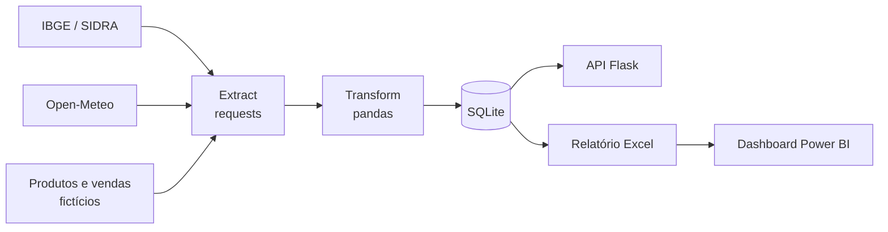

# 🌱 Agro Insights


Pipeline de dados **inspirado no setor agroquímico**: coleta dados públicos de produção agrícola e clima, trata com pandas, armazena em banco SQL, expõe via API Flask e entrega relatórios em Excel e Power BI.

> ⚠️ Projeto de portfólio. Usa apenas dados públicos e produtos/vendas **fictícios**. Não possui relação com nenhuma empresa.

## 🎯 Objetivo

Demonstrar, de ponta a ponta, o fluxo de trabalho de uma área de dados e produtos:

- **Extração** de APIs públicas (IBGE/SIDRA e Open-Meteo)
- **Transformação** e padronização com pandas
- **Modelagem e consultas** em SQL (SQLite)
- **Disponibilização** de dados via API REST (Flask)
- **Análise e visualização** em Excel e Power BI

## 🏗️ Arquitetura



## 🧰 Stack

| Camada | Tecnologia |
|---|---|
| Coleta | Python, requests |
| Tratamento | pandas |
| Banco | SQLite, SQLAlchemy, SQL |
| API | Flask |
| Relatórios | openpyxl / XlsxWriter, Power BI |
| Qualidade | pytest, ruff, pre-commit, GitHub Actions |

## 📁 Estrutura

```
agro-insights/
├── data/              # raw/ (bruto) e processed/ (tratado e banco)
├── sql/               # schema.sql e queries.sql
├── src/
│   ├── etl/           # extract.py, transform.py, load.py
│   ├── api/           # app.py (Flask)
│   └── reports/       # gerar_excel.py
├── dashboards/        # .pbix e prints
├── docs/              # diagramas e documentação
├── tests/
├── requirements.txt
└── README.md
```

## 🚀 Como executar

Pré-requisito: Python 3.10+.

```bash
git clone https://github.com/SEU_USUARIO/agro-insights.git
cd agro-insights

python -m venv .venv
source .venv/bin/activate        # Windows: .venv\Scripts\activate
pip install -r requirements.txt
cp .env.example .env             # Windows: copy .env.example .env

python -m src.etl.run_all        # coleta, trata e carrega
python -m src.reports.gerar_excel
flask --app src.api.app run
```

> Os comandos de ETL, relatório e API serão habilitados conforme o avanço do board.

## 🧪 Desenvolvimento

```bash
pip install -r requirements-dev.txt
pre-commit install
make test     # pytest
make lint     # ruff
```

Convenções:

- Commits no padrão [Conventional Commits](https://www.conventionalcommits.org/pt-br/) (`feat:`, `fix:`, `docs:`, `chore:`, `test:`)
- Uma branch por issue (`feat/4-extract-ibge`) e PR com `Closes #N`
- Gestão de tarefas no [board do projeto](https://github.com/users/SEU_USUARIO/projects/1)

## 🗺️ Roadmap

- [x] Setup do repositório
- [ ] ETL (IBGE, Open-Meteo, dados fictícios)
- [ ] Banco SQL e queries analíticas
- [ ] API Flask com testes
- [ ] Relatório Excel e dashboard Power BI
- [ ] Próximos passos: Docker, PostgreSQL, deploy

## 📸 Screenshots

_Em breve: board do Kanban, dashboard do Power BI e exemplos da API._

## 📄 Licença

MIT. Veja [LICENSE](LICENSE).
